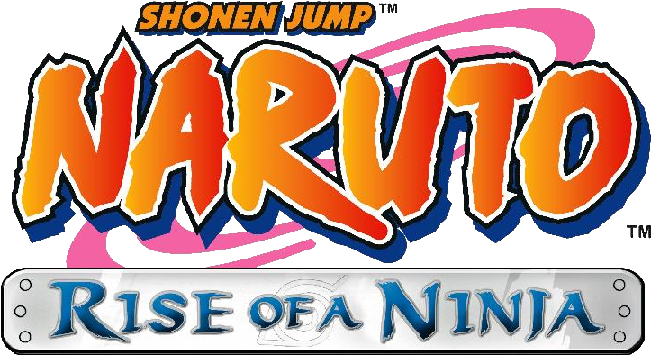

  

<h1 align="center">Naruto: Rise of a Ninja — Recomp</h1>

  A static recompilation for PC powered by ReXGlue 
  <strong>Native Direct3D 12 renderer with 60 and 120 FPS • Ultrawide • DLC support • Seven languages</strong>

  <a href="#installing">Installing</a> ·
  <a href="#updating">Updating</a> ·
  <a href="#native-renderer-and-60-fps">Native renderer and 60 FPS</a> ·
  <a href="docs/build-and-run.md">Build and run</a> ·
  <a href="docs/configuration.md">Configuration</a> ·
  <a href="docs/troubleshooting.md">Troubleshooting</a>

> [!WARNING]
> This project is a work in progress. Expect bugs, crashes, and visual issues; the native renderer, now the default, is the newest part, and Xenos remains available in the launcher if something does not look right. Keep a backup of your saves and report problems on the [Issues page](https://github.com/jorjbarbosa/naruto-rise-recomp/issues).

## About

A PC port of **Naruto: Rise of a Ninja**, originally released for Xbox 360. The project uses the [ReXGlue SDK](https://github.com/rexglue/rexglue-sdk) to translate the game's PowerPC code into C++ and compile it for native execution. The SDK runtime provides system services, audio, and input.

The game can be drawn by two renderers, chosen in the launcher: the **native renderer**, the default, which draws the game's Direct3D calls with Direct3D 12 and can present at 60 or 120 FPS, and **Xenos**, the SDK's emulation of the Xbox 360 GPU, as the alternative.

The current build and distribution workflow targets **Windows x64**. Presets for other platforms exist, but do not represent complete or verified support for this port.

> [!NOTE]
> AI tools are used to assist the development of this project. The project's direction, technical decisions, and testing are the maintainer's, who reviews every change before it is published.

## Features

**Graphics**

- **Two renderers:** the native Direct3D 12 renderer (default) and Xenos as the alternative. See [Native renderer and 60 FPS](#native-renderer-and-60-fps).
- **60 and 120 FPS** with the native renderer, keeping the game's logic at its original rate.
- **21:9 and 32:9 ultrawide** with the Xenos renderer, with projection adjustments and anamorphic presentation; a 16:9 option is available in the launcher.
- **Internal resolution from 1× to 4×** (also 1.5× with the native renderer), up to 16× anisotropic filtering, FXAA, FidelityFX CAS/FSR, fullscreen, and VSync.
- **Native renderer options:** MSAA (2×, 4×, 8×), transparency antialiasing, brightness, frame latency, and triple buffering.
- **Graphics card selection** for both renderers; hybrid laptops use the dedicated card by default.

**Content and languages**

- **DLC support**, with launcher import and STFS package installation at game startup. Character DLCs use additional recompiled engine modules.
- **Game language selection**, with English, French, German, Spanish, and Italian options in the launcher; available text and voices depend on your game files.
- **External translation mods**, selected in the launcher's game language list, with UTF-8 text replacements by ID and fallback to the original English text. Releases include the complete Brazilian Portuguese package. See the [translation mod guide](docs/translation-mods.md).

**Launcher and distribution**

- **Launcher** with settings grouped into Game, Display, Quality, Controls, and Advanced, a description of each option, DLC import, and the installed version. It is available in seven languages.
- **FPS and frametime overlay** (`F1`, Xenos renderer) showing the guest (game) and host frame rates, and an option to skip intro videos.
- **Shader caches:** the bundled Xenos shader storage is copied into the user cache; the native renderer's shaders are translated when the port is built and embedded in the executable.
- **Portable distribution and Windows installer**, with optional ISO import and a manual update mode for existing installations. The installer is also available in seven languages.

## Native renderer and 60 FPS

On Xbox 360, the game runs its logic in fixed steps: 30 per second in the open world and 60 in fights. The Xenos renderer keeps those rates. The native renderer can present more frames than the logic produces:

| | Xenos | Native (default) |
| --- | --- | --- |
| How it draws | Emulates the Xbox 360 GPU and the command buffers the game writes for it | Intercepts the game's Direct3D calls and issues them with Direct3D 12; the shaders are translated when the port is built |
| Frame rate | The game's: 30, and 60 in fights | 30, 60 or 120 in the launcher (up to 240 in `narutorise.toml`) |
| Aspect ratio | 16:9, 21:9, and 32:9 | 16:9, with bars on wider monitors |
| Options only in this renderer | Aspect ratio, dithering, `F1`/`F3` overlays | MSAA, transparency antialiasing, frame rate, brightness, frame latency, triple buffering |

The native renderer is the default: choose the rate with the **Frame rate** slider under **Settings → Display** in the launcher (60 by default). To use Xenos instead, select it in **Settings → Display → Renderer**. A configuration saved by an earlier build with Xenos selected keeps it until you change it. The renderer option exists only in builds that include the native renderer ([build guide](docs/build-and-run.md#native-renderer-optional)); other builds always use Xenos.

Above 30 FPS, the game's logic keeps its original step, and the renderer draws the frames in between by interpolating objects, characters' poses, and the camera between the last two logic steps. Game speed, physics, and timing stay those of the console. With VSync on, the rate does not exceed the monitor's refresh rate. The HUD minimap still updates at 30 FPS, and the image trails the logic by one step (up to about 33 ms in the open world).

See [Renderers and frame rate](docs/renderers.md) for how it works, its limits, and its known issues, and [Configuration](docs/configuration.md#renderer) for every option.

## Requirements

- Windows x64.
- A Direct3D 12-compatible GPU, for either renderer. The launcher uses Direct3D 11.
- The [Microsoft Visual C++ x64 Redistributable](https://aka.ms/vs/17/release/vc_redist.x64.exe).
- The files from your Xbox 360 copy of the game, including `default.xex`. The source tree does not include game data or DLC packages.
- An SDL-compatible controller is recommended. Keyboard and mouse can be turned on and mapped in the launcher; see [Keyboard and mouse](docs/configuration.md#keyboard-and-mouse).

## Installing

Download `NarutoRiseInstaller.exe` from the **Assets** of the latest Windows release on the [Releases page](https://github.com/jorjbarbosa/naruto-rise-recomp/releases). The installer includes the PC port; you must provide the original Xbox 360 game files separately. To build the port yourself, follow the [build guide](docs/build-and-run.md).

1. Run `NarutoRiseInstaller.exe` and choose the installer language.
2. Select **Install a new copy or import an ISO**.
3. Choose the destination folder. The default is `%LOCALAPPDATA%\NarutoRisePC`, a per-user installation that does not require administrator privileges.
4. Select the ISO from your Xbox 360 copy to extract it into `game/`, or leave the ISO field empty to use files you already extracted.
5. Choose the shortcuts, review the summary, and install.
6. Open `narutorise_launcher.exe`, select your monitor's aspect ratio, adjust settings, and launch the game.

If you skipped ISO import, place your extracted files in `game/` next to the launcher or select their folder in the launcher's **Game Files** tab. The selected game folder must contain `default.xex`. To import an ISO later, run the installer again and select **Install a new copy or import an ISO**; the destination's `game/` folder must be empty.

For the portable ZIP, extract it to a writable folder and run `narutorise_launcher.exe`. Place or select the extracted game files as described above. ISO import is available through the installer.

For additional content, see the [DLC guide](docs/dlc.md).

## Updating

Updates are installed manually with `NarutoRiseInstaller.exe` from a newer Windows release on the [Releases page](https://github.com/jorjbarbosa/naruto-rise-recomp/releases/latest). Use the same installer for a new installation or to update an existing copy.

1. Close the game and launcher.
2. Run the new `NarutoRiseInstaller.exe` and choose the installer language.
3. Select **Update an existing installation**. This option is preselected when an installation is detected in the initial destination.
4. Confirm the existing installation folder: it must contain both `narutorise.exe` and `narutorise_launcher.exe`. Select the PC port folder, rather than the folder containing only your Xbox 360 game files.
5. Review the destination and versions, apply the update, and reopen the launcher when it finishes.

The installer detects previous Inno Setup and legacy native installations, including custom destinations. For a portable copy, select its folder manually; updating it through the installer registers it as an installed Windows application and adds an uninstaller.

Updates replace the PC port binaries and bundled assets while preserving your game files, `narutorise.toml`, language preferences, saves, DLCs, and personal files. You do not need to uninstall the previous version or import your ISO again; the ISO page is skipped during an update. Existing `game/` and legacy `game_root/` folders are preserved.

See the [packaging guide](packaging/README.md) for installer details and command-line options.

## Documentation

| Guide | Contents |
| --- | --- |
| [Build and run](docs/build-and-run.md) | Toolchain, SDK, code generation, compilation, the native renderer, and first launch |
| [Configuration](docs/configuration.md) | Ultrawide, renderers, graphics, shortcuts, and user files |
| [Renderers and frame rate](docs/renderers.md) | Xenos and native renderers, 60 and 120 FPS, and known issues |
| [DLCs and Title Updates](docs/dlc.md) | Content installation and additional module build |
| [Architecture and analysis](docs/architecture.md) | Project structure, technical workflow, and areas to address |
| [Troubleshooting](docs/troubleshooting.md) | Build failures, runtime issues, and diagnostics |
| [Packaging](packaging/README.md) | Portable ZIP and Inno Setup installer |
| [Installer verification](docs/installer-status.md) | Existing tests and manual verification steps |

## Roadmap

Planned work, in no particular order:

- **Linux support.** Build presets exist, but the port has not been validated on Linux, and the launcher, preparation scripts, and installer still depend on Windows.
- **Vulkan.** Both renderers currently require Direct3D 12.
- **Ultrawide with the native renderer.** It currently draws at 16:9, with bars on wider monitors.
- **Graphics settings in game.** An overlay to change the graphics options while playing, kept in sync with the launcher. Today they are changed in the launcher.

## Contributing

Read the [technical analysis](docs/architecture.md) before changing the runtime or code generation files. When reporting an issue, include reproduction steps, version/build, CPU, GPU, driver, the renderer and frame rate you use, your configuration, and logs from `logs/` next to the executable. Also mention whether you use ultrawide, DLCs, or a Title Update.

Keep game files, content packages, derived shader data, and generated recompiled code out of commits. SDK changes should include reproducible patches in `patches/sdk/`.

## Credits

**Testing**

- [entityeternal](https://github.com/entityeternal), for testing the native renderer and frame rate builds and reporting issues.

**Projects and libraries**

- [ReXGlue](https://github.com/rexglue/rexglue-sdk), recompilation SDK and runtime.
- [Xenia](https://github.com/xenia-project/xenia) and [XenonRecomp](https://github.com/hedge-dev/XenonRecomp), foundations and references for the Xbox 360 recompilation ecosystem.
- [XenosRecomp](https://github.com/hedge-dev/XenosRecomp), shader translation for the native renderer (forked in `tools/xenosrecomp/`), and [Plume](https://github.com/renderbag/plume) with [D3D12 Memory Allocator](https://github.com/GPUOpen-LibrariesAndSDKs/D3D12MemoryAllocator), its Direct3D 12 backend.
- [SDL](https://github.com/libsdl-org/SDL), [Dear ImGui](https://github.com/ocornut/imgui), [AMD FidelityFX](https://github.com/GPUOpen-LibrariesAndSDKs/FidelityFX-SDK), [extract-xiso](https://github.com/XboxDev/extract-xiso), and [Inno Setup](https://jrsoftware.org/isinfo.php).

**References**

- [Unleashed Recompiled](https://github.com/hedge-dev/UnleashedRecomp), the model for the native renderer's design and its graphics card option.
- The Xenia Canary community and Hells Gate Recomp, references cited in the ultrawide implementation.
- Ubisoft Montreal, for the original game. [Logo source](docs/assets/README.md).

## License

Copyright (C) 2026 Jorge Barbosa. The source code of this port is licensed under version 3 of the [GNU General Public License](LICENSE) (GPL-3.0-only). The v0.2.0-beta.1 release was published under the MIT License.

Third-party code keeps its own license: the ReXGlue SDK (`sdk/`, BSD-3-Clause) and its dependencies, the XenosRecomp fork (`tools/xenosrecomp/`, MIT), Plume and D3D12 Memory Allocator (MIT, built into the executable with the native renderer), extract-xiso (`tools/extract-xiso/`), and the Lato fonts (`launcher/assets/fonts/`, OFL-1.1). Release packages include the notices of every component they ship in `licenses/` ([component list](packaging/third-party-licenses.psd1)).

Naruto: Rise of a Ninja, its content, and its artwork and trademarks, including the game artwork in `launcher/assets/` and `docs/assets/`, belong to their respective owners and are not covered by this license. No game data is distributed with this project.
